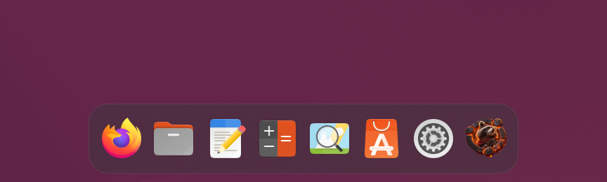
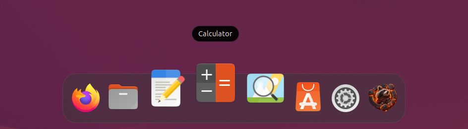

# Raccoon Dock

A small, macOS-style dock for GNOME, built from GNOME Shell's own Dash.

Raccoon Dock puts the Dash you already know from the Activities overview on your
desktop: the same pinned apps, running indicators and app grid button. On top of
that it adds a short list of carefully chosen options: smaller icons,
magnification, a frosted glass background, control over auto-hide and a choice
of monitor.

It's named after Ubuntu 26.04 "Resolute Raccoon", the release it was born on.





## Features

- **The real Dash.** No rebuilt dock. Your favorites, running apps and the
  app grid button behave exactly as they do in the overview.
- **Icon size.** Any size from 16 to 96 px. Icons still shrink if too many are open to fit.
- **Magnification.** Icons swell under the pointer and the dock grows evenly from
  its center, like on macOS. Icons stay sharp at full size.
- **Frosted glass.** A translucent, blurred background tinted to match your theme.
- **Raccoon app grid icon.** Swap the grid for the raccoon, or keep the grid.
- **Auto-hide, your way.** By default the dock steps aside for maximized, tiled
  and overlapping windows, and comes back when you push the pointer against the
  bottom edge. You choose how hard that push is, or turn auto-hide off entirely.
- **Click to minimize.** Clicking the app you're already using puts it away.
- **Launch bounce.** An app's icon bounces until its window opens.
- **Any monitor.** Put the dock on the screen you want. It moves to the primary
  one while that screen is unplugged and comes back when it returns.
- **Smooth with the overview.** The dock follows overview transitions and
  touchpad gestures one-to-one.

## Preferences

| Setting | What it does |
|---|---|
| Icon Size | Largest icon size in the dock |
| Raccoon App Grid Icon | Raccoon or the standard grid on the app grid button |
| Glass Background | Frosted glass or the theme's solid color |
| Monitor | Which screen shows the dock |
| Auto-Hide | Hide when a window overlaps the dock (fullscreen always hides it) |
| Reveal Pressure | How hard to push against the bottom edge to show a hidden dock |
| Click to Minimize | Clicking the app in front minimizes its windows on this workspace |
| Bounce While Launching | Bounce an app's icon until its window opens |
| Magnify Icons / Magnified Size | Turn magnification on and set the size of the icon under the pointer |

## Installation

1. Clone the repository into your extensions folder:
   ```bash
   git clone https://github.com/jkm-4314/raccoon-dock.git \
     ~/.local/share/gnome-shell/extensions/raccoon-dock@jkm-4314.github.io
   ```
2. Compile the settings schema:
   ```bash
   glib-compile-schemas ~/.local/share/gnome-shell/extensions/raccoon-dock@jkm-4314.github.io/schemas/
   ```
3. Log out and back in (GNOME on Wayland only discovers new extensions at login).
4. Enable it:
   ```bash
   gnome-extensions enable raccoon-dock@jkm-4314.github.io
   ```

Turn off Ubuntu Dock, Dash to Dock or Native Dock first, since they all take over the Dash.

## Requirements

GNOME Shell 50 on Wayland. Developed and tested on Ubuntu 26.04 with GNOME 50.

## Known limitations

- The glass blurs your wallpaper, not windows behind the dock.
- On a second monitor, the dock stays there while the Activities overview opens
  on the primary one.

## Testing

`tests/run.sh` starts a hidden, throwaway GNOME Shell with fresh settings,
loads the dock and checks it: showing, hiding, the edge reveal, click to
minimize, the launch bounce, monitor choice, the glass, and turning the
extension off and on. Your own desktop and settings are never touched.

```bash
tests/run.sh               # every check
tests/run.sh bounce        # only checks whose names contain "bounce"
tests/run.sh --screenshots # retake the screenshots above
```

## Credits

Raccoon Dock was inspired by [Native Dock](https://github.com/DEM0NAssissan7/native-dock)
by DEM0NAssissan7, and started as a fork of it, so its history includes Native Dock's. Native Dock does the hard work of
turning the Dash into a dock. If you'd rather have the original zero-configuration
experience, use Native Dock. Fixes that suit the original are contributed back upstream.

The Resolute Raccoon artwork is by [Josh McFall](https://github.com/jkm-4314).

Raccoon Dock is an independent project and isn't affiliated with Canonical or Ubuntu.

## License

GPL-3.0-or-later
